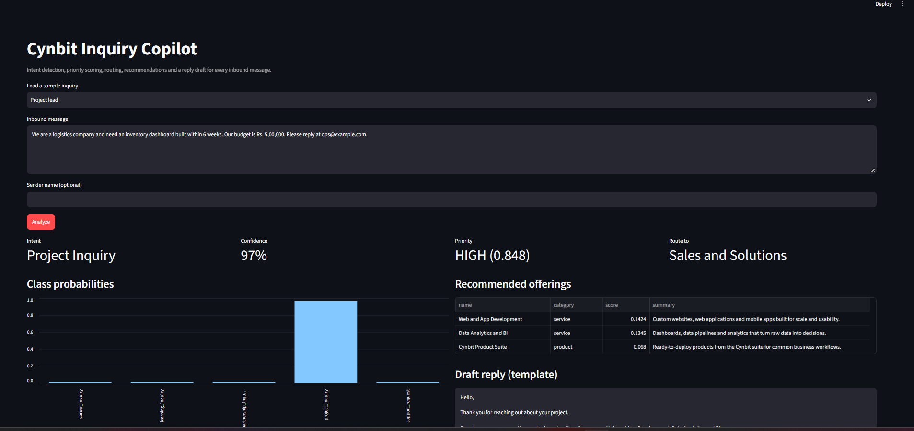
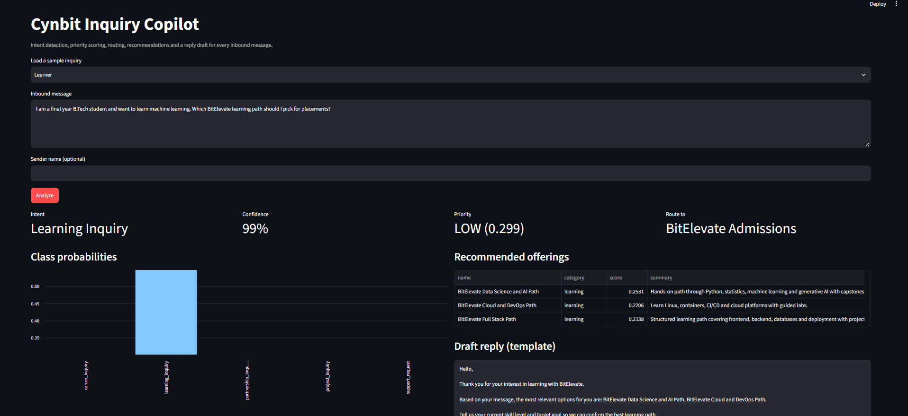

# Cynbit Inquiry Copilot

AI/ML Engineer Intern assessment submission for Cynbit: an inquiry triage and response copilot that detects intent, extracts budget and timeline, scores priority, routes to the right team, recommends offerings and drafts a grounded reply.

## Deliverables

| Deliverable | Location |
|---|---|
| AI Opportunity Report | docs/01_AI_Opportunity_Report.md |
| AI/ML Proof of Concept | src/, app/, api/, scripts/ |
| Technical Approach Report | docs/02_Technical_Approach_Report.md |
| Portal execution notes | docs/03_Submission_Notes.md |

## Demo screenshots





## Structure

```
cynbit-ai-inquiry-copilot/
  api/main.py
  app/streamlit_app.py
  data/knowledge_base.json
  data/handwritten_eval.csv
  docs/
  scripts/train.py
  scripts/evaluate.py
  scripts/demo_cli.py
  src/cynbit_copilot/
    classifier.py
    config.py
    data_gen.py
    drafter.py
    pipeline.py
    retriever.py
    schemas.py
    scoring.py
  tests/
```

## Run

```
python -m venv .venv
.venv\Scripts\activate
pip install -e ".[dev]"
python scripts/train.py
python scripts/evaluate.py
pytest -q
streamlit run app/streamlit_app.py
```

## API

```
uvicorn api.main:app --reload
```

Open http://127.0.0.1:8000/docs and try the POST /analyze endpoint with this body:

```
{"text": "We need an inventory dashboard in 6 weeks, budget Rs. 5 lakh", "sender_name": "Ravi"}
```

## CLI

```
python scripts/demo_cli.py "I cannot log in to the student dashboard, please fix urgently"
```

## Optional LLM drafting

Set `ANTHROPIC_API_KEY` and install the extra with `pip install -e ".[llm]"`. Without a key, a deterministic template is used.

## Results

| Evaluation | Accuracy | Macro F1 |
|---|---|---|
| Synthetic hold-out (400) | 1.00 | 1.00 |
| Hand-written set (19) | 0.89 | 0.89 |

The synthetic score only verifies the pipeline. The hand-written score is the realistic indicator.
